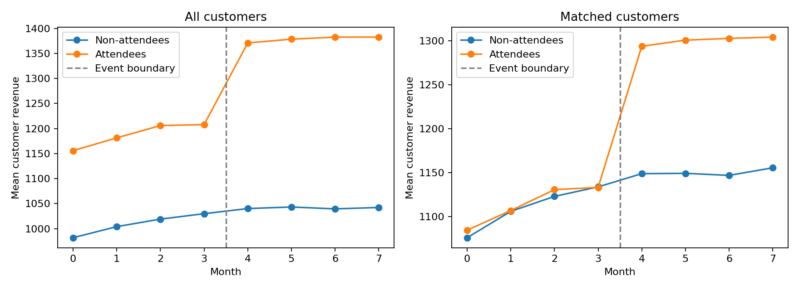
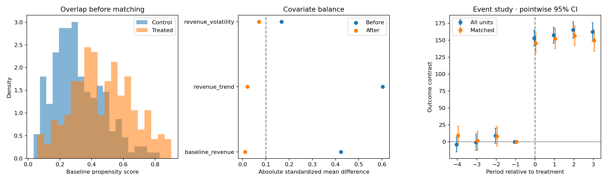

# Marketing event attendance: customer revenue impact

Outcome: customer revenue per period. Treatment: marketing-event attendance. Synthetic examples are demonstrations, not real findings.

| Estimator | Estimate | 95% CI |
|---|---:|---:|
| did | 158.327 | [150.738, 165.915] |
| psm_post_att | 150.353 | [88.294, 212.412] |
| matched_did | 146.194 | [137.804, 154.584] |

Matched pairs: 177; treated retention: 79.4%.

## Interpretation and limitations

- Causal interpretation requires the documented identification assumptions.
- PSM and matched DiD target retained treated units, not necessarily all treated units.
- Matched confidence intervals condition on matches and omit propensity estimation uncertainty.
- Independent units are assumed. Cluster-assigned treatment requires cluster-level inference.
- Event-study intervals are pointwise. Insignificant pretrends do not establish parallel trends.
- Less than 80% of treated units retained; examine changes in the target population.

## Covariate balance

| Baseline feature | SMD before | SMD after |
|---|---:|---:|
| baseline_revenue | 0.423 | 0.011 |
| revenue_trend | 0.603 | 0.021 |
| revenue_volatility | -0.168 | 0.071 |

See docs/methodology.md for estimands, assumptions, and inference limits.
